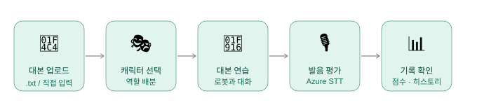
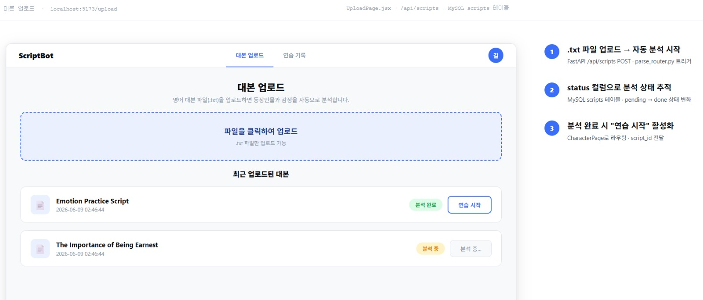
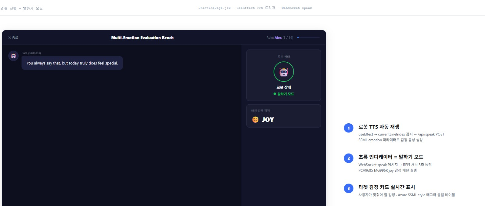
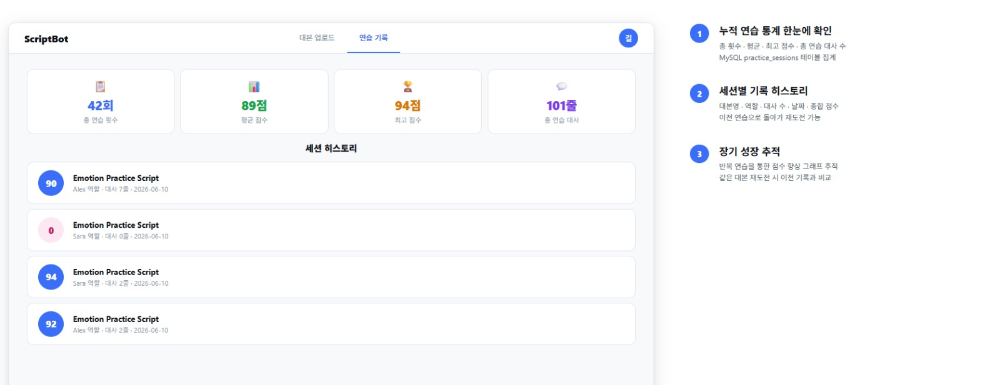
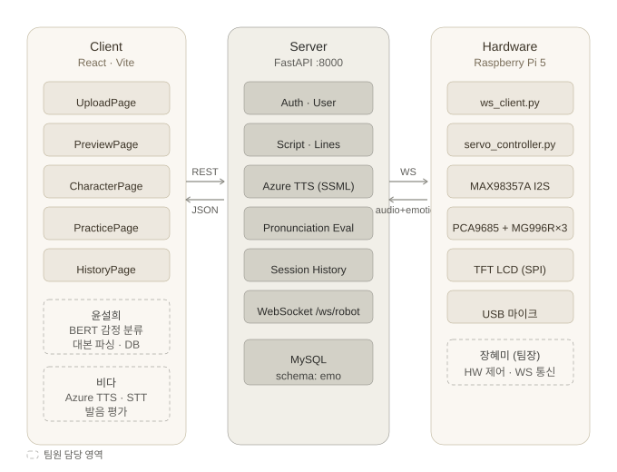

# Triplelingo 🤖


영어 대본 연습용 로봇 시스템.  
사용자가 웹에 영어 대본을 업로드하면, Raspberry Pi 5 기반 로봇이 상대방 역할을 수행하며 발음 피드백을 제공한다.

---

## Triplelingo를 통해 할 수 있는 것 :3






---

## 주요 기능
 
| 기능 | 설명 |
|------|------|
| 📄 대본 업로드 & 파싱 | TXT 대본 업로드(카테고리·난이도 지정) → `인물: 대사` 형식으로 등장인물·대사 자동 분리 후 DB 저장, 대본 삭제 |
| 🧠 감정 분류 | DistilRoBERTa 기반 7감정 분류(앞 3줄 문맥 반영) → 서보 동작 패턴 자동 매핑 |
| ✏️ 감정 수정 | 미리보기 화면에서 대사별 감정 수정 → DB에 즉시 저장 |
| 🔊 TTS 음성 생성 | Azure Neural TTS + SSML 감정 스타일 적용 (Andrew / Ava Neural) |
| 🤖 로봇 제어 | WebSocket으로 RPi5에 오디오 + 감정 + viseme 전송 → 서보 고갯짓 + I2S 재생 + LCD 립싱크 |
| 🎧 그냥 듣기 모드 | 녹음·평가 없이 모든 대사를 로봇 음성으로 연속 청취 |
| 🎙️ 발음 평가 | Azure Pronunciation Assessment → 정확도·유창성·완성도 점수 + 단어별 피드백 (80점 미만 시 Ollama 맞춤 피드백) |
| 🔈 로봇 상태·볼륨 | 연습 화면에서 로봇 연결 상태 표시, 스피커 볼륨 조절 |
| 📊 연습 기록 | 연습 결과 저장 및 히스토리·상세 조회 |
| 🧭 사용 가이드 | 대본 선택부터 결과 리포트까지 5단계 흐름을 클릭 시뮬레이션으로 안내 |


---

## 시스템 구성

```
Triplelingo/
├── frontend/     ← React 프론트엔드 (Vite)
├── server/       ← FastAPI 백엔드 (main.py, ws_router.py, database.py)
├── hardware/     ← Raspberry Pi 5 제어 코드 (ws_client.py, servo_controller.py, lcd_mouth.py)
├── database/     ← MySQL 스키마·샘플 데이터·마이그레이션
└── docs/         ← 문서·다이어그램
```

---

## 기술 스택

| 구분 | 기술 |
|------|------|
| 프론트엔드 | React (Vite), JavaScript |
| 백엔드 | FastAPI (Python 3.11), SQLAlchemy |
| 하드웨어 | Raspberry Pi 5, PCA9685, MG996R 서보 × 3, MAX98357A I2S, 3.5인치 TFT LCD |
| AI/ML | Azure TTS/STT, Azure Pronunciation Assessment, DistilRoBERTa 감정 분류, Ollama(mistral) 피드백 |
| DB | MySQL 8.0 |
| 통신 | WebSocket (RPi5 ↔ 서버), REST API (프론트 ↔ 서버) |

---

## 실행 방법

### 0. 사전 준비

| 프로그램 | 용도 | 필수 여부 |
|----------|------|----------|
| MySQL Server 8.0 | DB (윈도우 서비스로 실행 중이어야 함) | 필수 |
| Python 3.11 | 백엔드 | 필수 |
| Node.js (LTS) | 프론트엔드 | 필수 |
| ffmpeg (PATH 등록) | 녹음 파일(webm) 변환 — 없으면 발음 평가 실패 | 필수 |
| Ollama + `mistral` | 80점 미만 시 맞춤 피드백 (꺼져 있으면 고정 문구로 대체) | 선택 |

### 1. 데이터베이스

MySQL Workbench에서 SQL 파일을 열고 전체 실행(⚡)합니다. UPDATE 문이 있으므로 **Safe Updates를 끈 상태**(`SET SQL_SAFE_UPDATES = 0;`)에서 실행합니다.

| 상황 | 실행 순서 |
|------|----------|
| 새로 설치 | `triplelingo_schema_latest.sql` → `triplelingo_sample_data.sql` (1회만) |
| 기존 DB 업데이트 | (백업 후) `triplelingo_schema_latest.sql` → `migrate_20261103_web_merge.sql` |

`server/database.py`의 접속 비밀번호를 본인 MySQL root 비밀번호로 맞춥니다.
```python
DATABASE_URL = "mysql+pymysql://root:<비밀번호>@127.0.0.1:3306/triplelingodb"
```

### 2. 백엔드 서버

```bash
cd server
python -m venv .venv
.venv\Scripts\activate           # macOS/Linux: source .venv/bin/activate
pip install fastapi uvicorn websockets python-dotenv python-multipart sqlalchemy pymysql requests azure-cognitiveservices-speech pydub numpy transformers torch
```

`server/.env` 파일 생성:
```
AZURE_SPEECH_KEY=your_key
AZURE_SPEECH_REGION=your_region
```

```bash
uvicorn main:app --reload --host 0.0.0.0 --port 8000
```

> `--host 0.0.0.0`이 없으면 RPi5가 서버에 접속할 수 없습니다. 첫 실행 시 윈도우 방화벽에서 **개인 네트워크 허용**을 선택합니다.  
> 대본을 처음 열 때 감정 분석 모델을 내려받느라 수십 초 걸릴 수 있습니다.

### 3. 프론트엔드

```bash
cd frontend
npm install
npm run dev
```

브라우저(Chrome)에서 `http://localhost:5173` 접속 — 테스트 계정 `hong@example.com` / `12345678`

### 4. RPi5 하드웨어 클라이언트

노트북과 RPi5를 같은 네트워크에 연결한 뒤, 노트북 IP(`ipconfig`의 IPv4 주소)를 확인합니다.

```bash
source ~/robot/.venv/bin/activate
cd ~/robot
python -u ws_client.py                                 # 기본 서버 주소 사용
SERVER_HOST=192.168.137.1 python -u ws_client.py       # 서버 주소 지정 (예: 노트북 핫스팟)
```

> 서버가 먼저 실행된 상태여야 WebSocket 연결이 됩니다.  
> 기본 연결 주소: `ws://192.168.0.102:8000/ws/robot` (`SERVER_HOST`, `SERVER_PORT` 환경변수로 변경)

### 실행 순서 요약

```
MySQL 확인 → (Ollama) → 백엔드 서버 → 프론트엔드 → RPi5 클라이언트 → 브라우저 접속
```

---

## 시스템 흐름 및 담당 역할



---

## API 엔드포인트

### 인증·사용자
| Method | Endpoint | 설명 |
|--------|----------|------|
| POST | `/register` | 회원가입 |
| POST | `/login` | 로그인 |
| PUT | `/api/users/profile` | 프로필 수정 |
| GET | `/users` | 사용자 목록 (관리자) |
| PATCH | `/users/{id}` · `/users/{id}/status` | 사용자 정보·상태 수정 (관리자) |
| DELETE | `/users/{id}` | 사용자 삭제 (관리자) |

### 대본
| Method | Endpoint | 설명 |
|--------|----------|------|
| GET | `/scripts` | 대본 목록 (카테고리·난이도 포함) |
| POST | `/scripts/upload` | TXT 대본 업로드 → 파싱·감정 분류 후 저장 |
| DELETE | `/scripts/{id}` | 대본 삭제 (대사 함께 삭제) |
| GET | `/api/scripts/{id}` | 대본 상세 (대사·감정, 대사가 없으면 자동 분석) |
| PATCH | `/api/scripts/{id}/lines/{line_id}/emotion` | 대사 감정 수정 |
| GET | `/api/scripts` | 전체 대본 목록 (구버전) |
| POST | `/scripts` | 대본 저장 (구버전) |
| POST / GET | `/api/scripts/{id}/lines` | 대사 라인 저장·조회 |
| PATCH | `/api/lines/{id}/emotion` | 감정 수정 (구버전) |

### 로봇 제어
| Method | Endpoint | 설명 |
|--------|----------|------|
| POST | `/api/robot/speak` | TTS·viseme 생성 후 RPi5 전송, 재생 시간 반환 |
| POST | `/api/robot/standby` | 사용자 차례 전환 (LCD 발화 파형 시작) |
| POST | `/api/robot/end_recording` | 녹음 종료 신호 전송 |
| GET | `/api/robot/status` | RPi5 연결 여부 |
| GET / POST | `/api/robot/volume` | 로봇 스피커 볼륨 조회·변경 |
| WS | `/ws/robot` | RPi5 WebSocket 연결 |

### 발음 평가
| Method | Endpoint | 설명 |
|--------|----------|------|
| POST | `/api/evaluate` | 음성 파일 업로드 → 발음 점수·피드백 반환 |
| POST | `/api/speak` | 브라우저 TTS 재생 (테스트용) |

### 연습 기록
| Method | Endpoint | 설명 |
|--------|----------|------|
| POST | `/practice-results` | 연습 결과 저장 |
| GET | `/practice-results/{user_id}` | 사용자 연습 기록 조회 |
| GET | `/practice-results/detail/{result_id}` | 연습 상세 조회 |
| POST / GET | `/api/sessions` · `/api/sessions/{user_id}` | 연습 세션 (현재 미사용) |

---

## 하드웨어 구성

| 부품 | 인터페이스 | 역할 |
|------|-----------|------|
| Raspberry Pi 5 | — | 중앙 컨트롤러 |
| PCA9685 | I²C (0x40) | 서보 PWM 드라이버 |
| MG996R × 3 | PWM | TILT / ROLL / PAN 3축 |
| MAX98357A | I2S | TTS 음성 출력 |
| 3.5인치 TFT LCD | SPI | 입 모양 립싱크(viseme), 사용자 발화 파형 표시 |
| USB 마이크 | USB 3.0 | 음성 입력 |

---

## 팀

| 이름 | 담당 | 개인 깃 주소 |
|------|------|-------------|
| 장혜미 (팀장) | 하드웨어 제어, WebSocket 통신, RPi5 클라이언트 | https://github.com/jang-hyemi |
| 윤설희 | 감정 분류, 대본 파싱, MySQL DB 설계 |  https://github.com/tjfgml12 |
| 비다 | TTS/STT/발음 평가, React 프론트엔드 | https://github.com/vida2398 |
